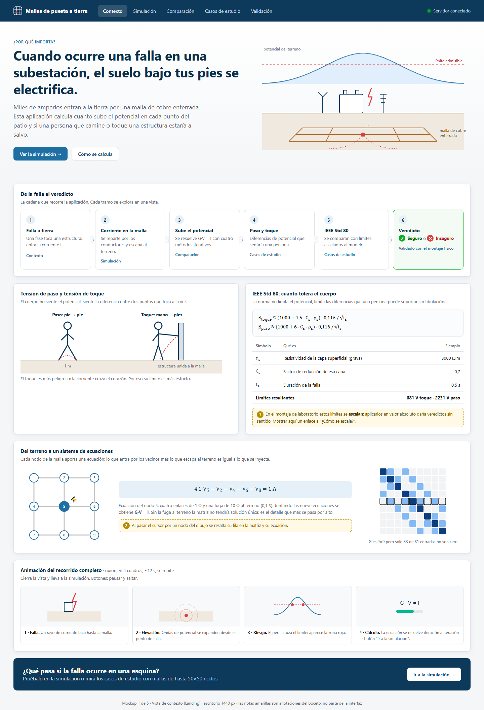
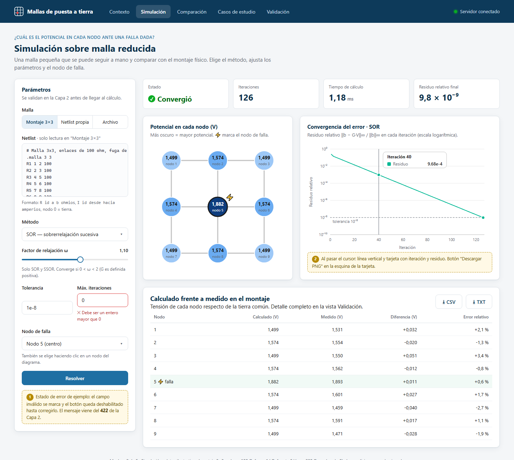
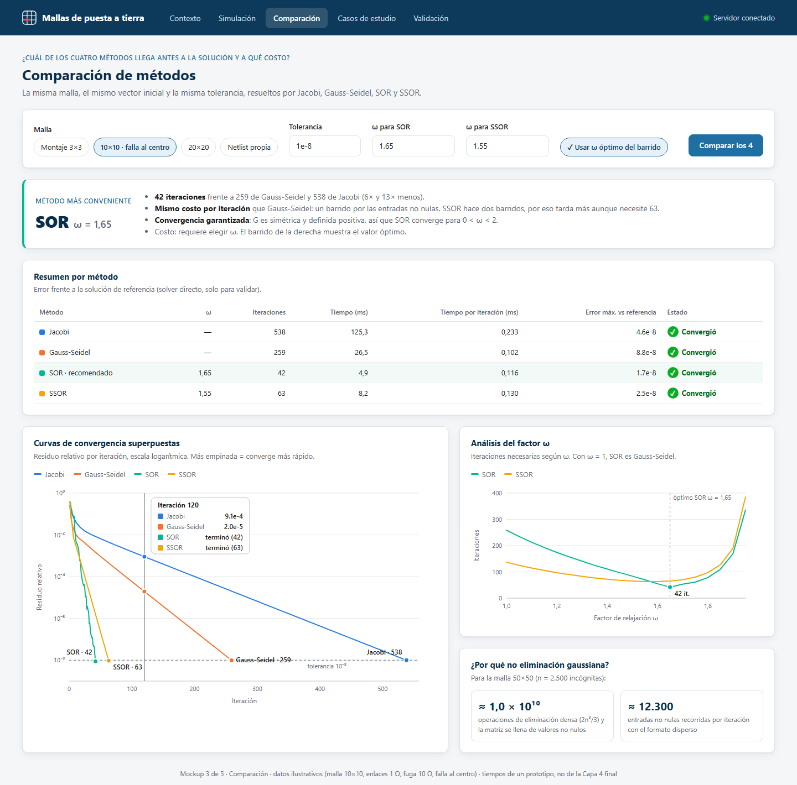
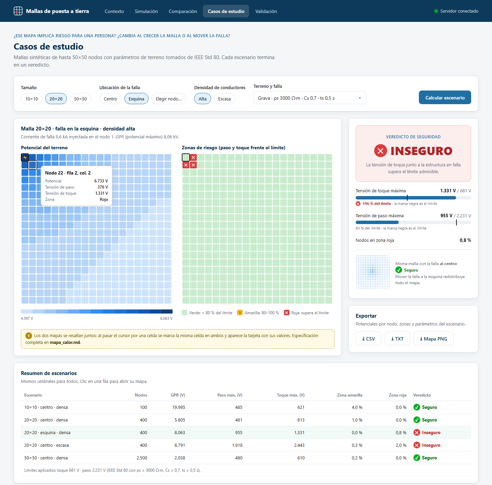
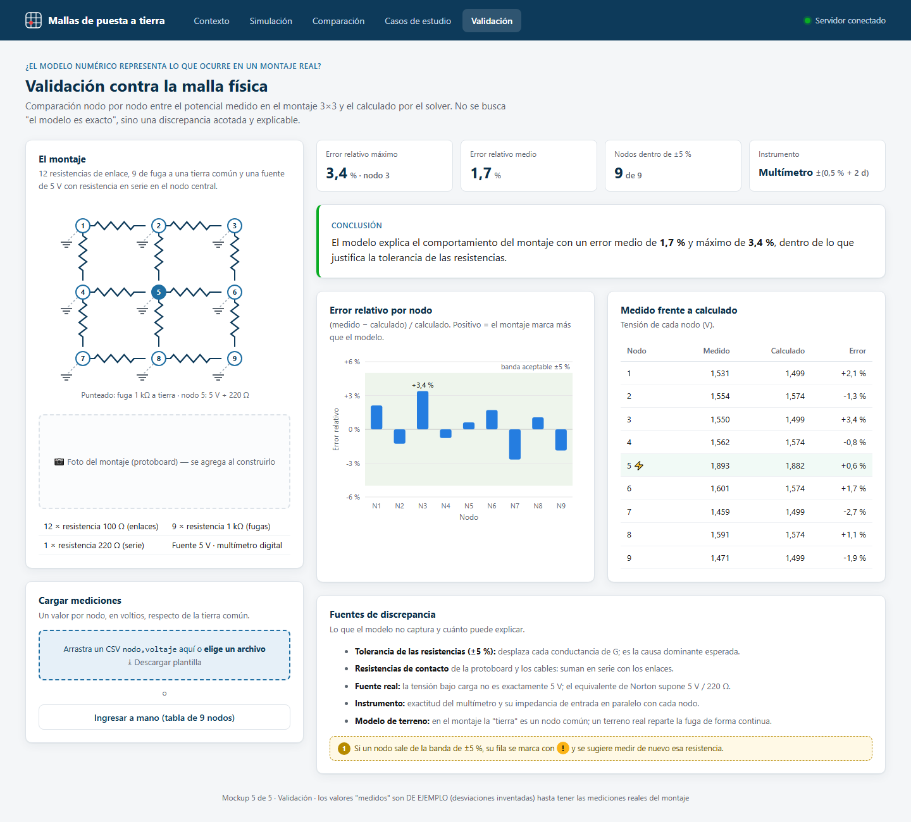

# Mockups de la interfaz (Capa 1)

Boceto digital de las cinco vistas de la aplicación, en escritorio (1440 px). Cada vista responde a una de las preguntas del proyecto.

| # | Vista | Pregunta que responde | Boceto |
| --- | --- | --- | --- |
| 1 | **Contexto** (landing) | ¿Por qué importa? ¿Qué es una falla, la tensión de paso y la de toque? | [captura](capturas/1_contexto.png) · [HTML](1_contexto.html) |
| 2 | **Simulación** | ¿Cuál es el potencial en cada nodo ante una falla dada? | [captura](capturas/2_simulacion.png) · [HTML](2_simulacion.html) |
| 3 | **Comparación** | ¿Qué método llega antes y a qué costo? ¿Qué ω conviene? | [captura](capturas/3_comparacion.png) · [HTML](3_comparacion.html) |
| 4 | **Casos de estudio** | ¿El mapa implica riesgo? ¿Cambia al crecer la malla o mover la falla? | [captura](capturas/4_casos.png) · [HTML](4_casos.html) |
| 5 | **Validación** | ¿El modelo representa lo que ocurre en el montaje real? | [captura](capturas/5_validacion.png) · [HTML](5_validacion.html) |

Especificación del mapa de calor y del semáforo: [`mapa_calor.md`](mapa_calor.md).

## Cómo verlos

- En GitHub: abrir las capturas PNG (abajo).
- Con interacción y a tamaño real: abrir los `.html` en un navegador (no necesitan servidor ni internet).

Las **notas amarillas numeradas** son anotaciones del boceto (comportamientos, estados de error, hover), no elementos de la interfaz.

## Datos

Los números de los bocetos no son inventados a mano: salen de la Capa 3 real (`construir_sistema`, `generar_malla`, `potenciales_a_grilla`) y de un solver de prueba, y están en `datos_mockups.js`. Son **ilustrativos**:

- Los tiempos son de un prototipo, no de la Capa 4 final.
- Los valores "medidos" de Simulación y Validación son **de ejemplo** (desviaciones inventadas) hasta tener las mediciones del montaje.
- La definición de la tensión de toque (persona a un nodo de la estructura en falla) y el escalado de los límites de IEEE Std 80 son provisionales: los fija el documento técnico.

## Decisiones de diseño

- **Una pregunta por vista**, escrita arriba del título; la barra superior lleva a las cinco y muestra el estado del servidor (`GET /health`).
- **Color con función fija**: cada método tiene siempre el mismo color en todas las vistas (Jacobi azul, Gauss-Seidel naranja, SOR aqua, SSOR amarillo); el potencial usa una escala azul de un solo tono; verde/amarillo/rojo se reservan para riesgo y siempre van con icono y texto (legible con daltonismo).
- **Convergencia en escala logarítmica** con la tolerancia como línea de referencia; todas las gráficas con leyenda, etiquetas directas y tarjeta al pasar el cursor.
- **El veredicto es una palabra** (Seguro / Inseguro) con la explicación de qué límite se superó: es lo que necesita el público de la feria.
- **Errores de validación en línea**, junto al campo, con el mensaje que devuelve la Capa 2.

## Capturas

### 1 · Contexto

### 2 · Simulación

### 3 · Comparación

### 4 · Casos de estudio

### 5 · Validación

